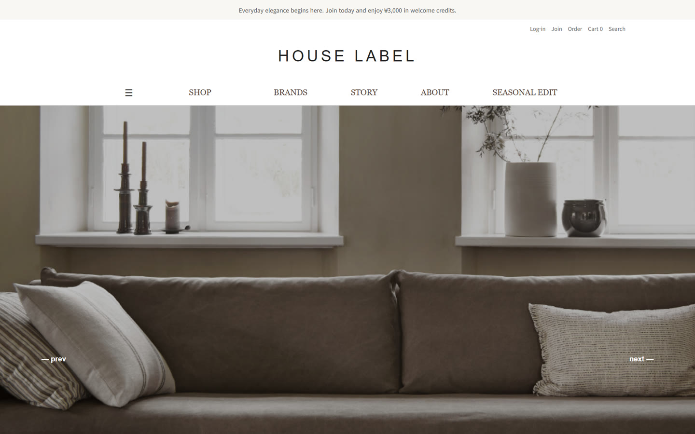
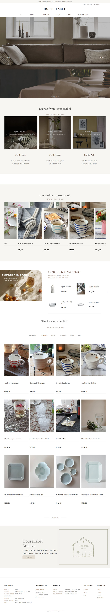
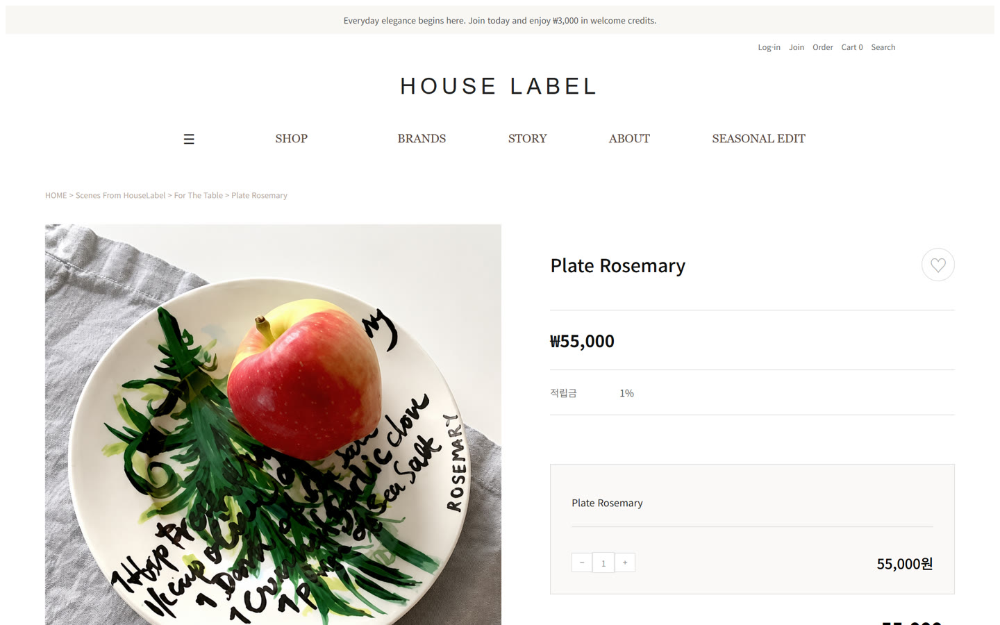
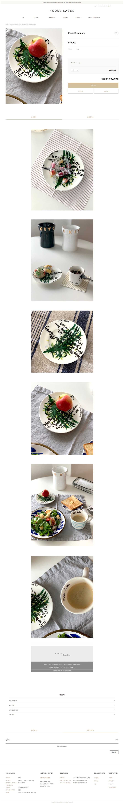
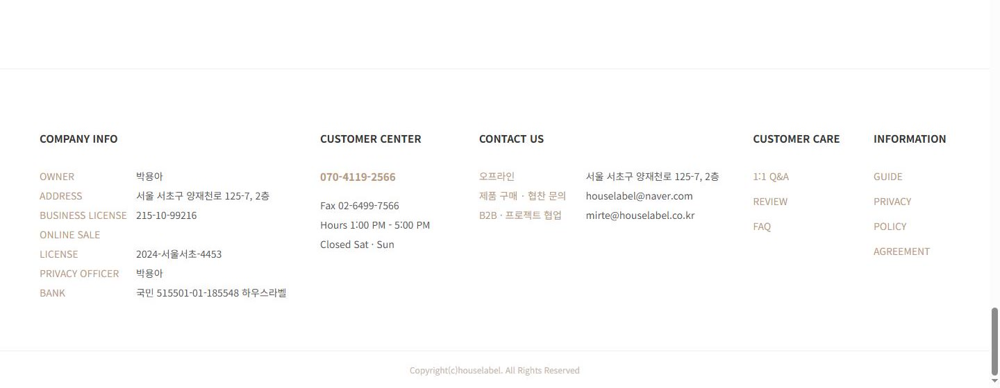

<b>HOUSE LABEL</b><br>
테이블웨어 · 홈 데코 리빙 편집숍 쇼핑몰의 <b>메인 · 상품 상세 페이지</b>를 HTML · CSS · JavaScript로 만든 퍼블리싱 프로젝트



<table>
  <tr><th align="left" width="130">기간</th><td>2026.08</td></tr>
  <tr><th align="left">형태</th><td>개인 프로젝트</td></tr>
  <tr><th align="left">역할</th><td>기획 · 디자인 · 퍼블리싱 · 기능 구현 (1인)</td></tr>
  <tr><th align="left">기술</th><td>HTML · CSS · JavaScript(ES 모듈) · JSON · GitHub Pages</td></tr>
  <tr><th align="left">링크</th><td><a href="https://haru40.github.io/0826/">사이트 바로가기 ↗</a></td></tr>
</table>

---

## 목차

- **화면** — [1. 메인 페이지](#s1) · [2. 상품 상세 페이지](#s2)
- **구현** — [3. 주요 기능](#s3) · [4. JSON 데이터 연동](#s4)
- **개선** — [5. 화면 잘림 수정](#s5)
- **구조** — [6. 프로젝트 구조](#s6)

---

<a name="s1"></a>

## 1. 메인 페이지

<details>
<summary><b>홈 화면 전체 보기 (펼치기)</b></summary>



</details>

| 섹션 | 내용 |
|---|---|
| 메인 슬라이드 | 5장 · 자동 전환 · 이전/다음 버튼 · 점 클릭 이동 |
| Scenes from HouseLabel | For the Table · Home · Wall 3가지 공간 제안 |
| Curated by HouseLabeL | 추천 상품 10개 · 자동 슬라이드 · 마우스 올리면 멈춤 |
| Summer Living Event | 여름 기획전 ↔ 선물 기획전 화살표 전환 · 상품 4개 |
| The HouseLabel Edit | 상품 12개 카드 목록 → 상세 페이지 이동 |
| HouseLabel Archive | 브랜드 아카이브 소개 |

---

<a name="s2"></a>

## 2. 상품 상세 페이지



<details>
<summary><b>상세 페이지 전체 보기 (펼치기)</b></summary>



</details>

- 상품 사진 · 이름 · 가격 · 수량 선택 · 총 상품 금액
- **수량 + / − 버튼** — 수량에 맞춰 총 금액을 바로 다시 계산 (1개 미만으로는 내려가지 않음)
- **장바구니** — 상품 이름 · 가격 · 수량을 브라우저 저장소(localStorage)에 담기
- **바로 구매** — 선택한 수량과 총 금액 안내
- 상세 이미지 · 이용 안내(펼치기 / 접기) · Q&A

---

<a name="s3"></a>

## 3. 주요 기능

| 기능 | 구현 |
|---|---|
| 메인 슬라이드 | 자동 전환 + 버튼 · 점으로 이동, 조작 후 자동 타이머 다시 시작 |
| 큐레이션 슬라이드 | 4초 자동 이동, 마우스를 올리면 멈추고 떼면 다시 시작 |
| 기획전 전환 | 여름 기획전 · 선물 기획전 데이터를 묶어 화살표로 전환 |
| 스크롤 등장 효과 | `IntersectionObserver`로 섹션이 화면에 들어오면 아래에서 떠오르듯 등장 |
| 공통 헤더 · 푸터 | `common/` 의 HTML 조각을 두 페이지에서 함께 사용 |
| 모듈 구조 | 섹션별 JS를 `js/modules/` 6개 파일로 나누고 `main.js`에서 불러옴 |

---

<a name="s4"></a>

## 4. JSON 데이터 연동

상품 · 섹션 내용을 HTML에 직접 쓰지 않고 **JSON 파일로 분리**해 `fetch`로 불러와 화면을 채움 — 상품을 바꿀 때 JSON만 고치면 됨

| 파일 | 섹션 | 데이터 |
|---|---|---|
| `Scenes.json` | Scenes from HouseLabel | 공간 3개 (제목 · 문구 · 이미지) |
| `HouseLabeL.json` | Curated by HouseLabeL | 추천 상품 10개 (순위 · 이름 · 가격 · 이미지) |
| `event.json` | Summer Living Event | 여름 기획전 상품 4개 |
| `gift.json` | Gift Selection | 선물 기획전 배너 + 상품 |
| `Edit.json` | The HouseLabel Edit | 상품 12개 |

---

<a name="s5"></a>

## 5. 화면 잘림 수정

**문제** — 화면 폭보다 큰 고정 크기 때문에 페이지가 옆으로 넓어지고(가로 스크롤), 오른쪽이 잘림

| 위치 | 원인 | 수정 |
|---|---|---|
| 푸터 | 칸 최소 너비 + 간격 90px × 칸 수가 푸터 폭(75%)보다 큼 → 마지막 칸이 화면 밖으로 | 최소 너비 · 간격 축소, 좁으면 다음 줄로 넘어가게(`flex-wrap`) |
| 여름 이벤트 상품 | 상품 칸이 `400px 400px`로 고정, 들어갈 영역(약 690px)보다 넓음 | 남은 공간을 둘로 나눠 사용 (`repeat(2, minmax(0, 1fr))`) |

**결과** — 1280 · 1440 · 1920px 화면 모두 가로 스크롤 없이 표시, 1440px에서 푸터 5칸이 한 줄에



---

<a name="s6"></a>

## 6. 프로젝트 구조

```
├── index.html          메인 페이지
├── detail.html         상품 상세 페이지
├── common/
│   ├── header.html     공통 헤더
│   └── footer.html     공통 푸터
├── css/                header · footer · main · slider · scenes · summer · archive · detail
├── js/
│   ├── common.js       헤더 · 푸터 불러오기
│   ├── main.js         메인 모듈 실행
│   ├── detail.js       수량 · 가격 · 장바구니 · 이용 안내
│   └── modules/        slider · scenes · curated · summer · edit · scrollReveal
├── json/               섹션별 상품 · 콘텐츠 데이터 5개
└── img/                섹션별 이미지
```
